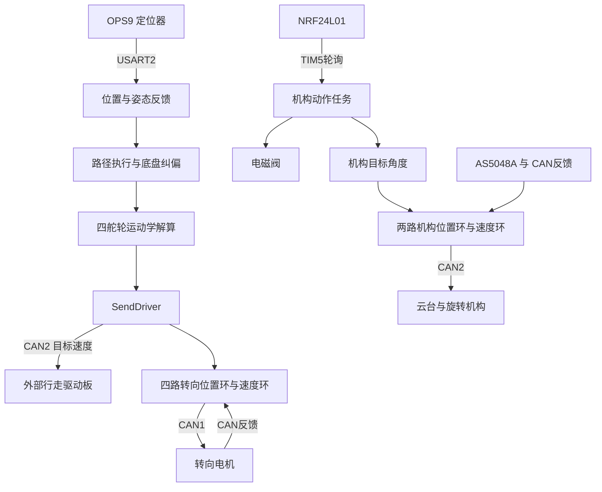

# DR-FreeRTOS：四舵轮机器人控制系统

基于 **STM32F407ZG、FreeRTOS V9.0.0 和 STM32 标准外设库**的机器人嵌入式控制工程，集成四舵轮底盘、OPS9 定位器、AS5048A 磁编码器、NRF24L01 无线通信及发射机构。

当前主流程支持五段预设路径顺序执行、位置与姿态纠偏、终点驻车，以及无线触发的机构动作。本仓库保存现有固件和 Keil 工程；以下说明依据源码整理，配置的速度、容差和延时不代表实测性能。

## 1. 主要功能

| 功能 | 当前实现 |
| --- | --- |
| 底盘路径执行 | 根据 OPS9 反馈依次运行五段预设路径，接近目标后制动、纠偏，最终保持位置 |
| 四舵轮运动学 | 世界坐标到车体坐标转换、平移与旋转速度合成、各轮速度和方向解算、轮速反向策略 |
| 电机闭环 | 4 路转向电机与 2 路机构电机的位置 PD—速度 PI 串级控制，包含速度斜坡、死区、积分及输出限幅 |
| 定位与角度反馈 | OPS9 数据帧解析、定位安装偏移补偿、电机反馈解析、角度多圈累计及磁编码器读取 |
| 无线动作 | NRF24L01 接收动作指令，控制电磁阀和机构目标角度切换 |
| 调试输出 | USART1 DMA 缓冲输出定位与动作日志 |

四个行走轮的目标速度通过 CAN2 发往外部驱动板。本工程直接执行转向及机构电机闭环，**不包含外部行走驱动板固件**。

## 2. 系统架构



### 启动流程

`main()` → `System_Init()` → 创建启动任务 → 启动调度器 → 创建 4 个业务任务。

`System_Init()` 初始化路径、PID、GPIO、通信和定时器，随后等待无线模块检查通过及 OPS9 首帧有效格式的数据到达。**满足初始化条件后，路径任务会自动开始运动，不需要额外的启动命令。**

### FreeRTOS 任务

系统 Tick 为 1 ms，使用抢占式调度、同优先级时间片和 `heap_4`，RTOS 堆配置为 20 KB。

| 任务 | 优先级 | 栈大小 | 职责 | 循环延时 |
| --- | ---: | ---: | --- | --- |
| `task1_task` | 4 | 128 words / 512 B | 无线动作执行、电磁阀控制、机构目标切换 | 20 ms；部分动作内部等待 700 ms |
| `task2_task` | 4 | 512 words / 2048 B | 五段路径、底盘制动和终点保持 | 运动及制动循环通常为 10 ms |
| `task3_task` | 3 | 128 words / 512 B | AS5048A 角度采集 | 3 ms |
| `task4_task` | 2 | 128 words / 512 B | 两路机构电机闭环及 CAN 输出 | 15 ms |

上表为 `vTaskDelay()` 的延时配置，实际周期还包括计算、日志和调度耗时。底盘转向闭环在 `SendDriver()` 调用中执行，并非独立的第五个任务。

第五段路径在到位后持续保持位置，正常情况下不返回；因此 `task2_task` 尾部的零速循环不会在完成五段路径后自动进入。

## 3. 硬件与通信接口

引脚来自当前源码配置。移植到其他控制板前，应按实际原理图核对供电、引脚复用、收发方向和驱动电路。

| 模块 | 接口 | MCU 引脚 | 配置与用途 |
| --- | --- | --- | --- |
| 转向电机 | CAN1 | PA11 RX、PA12 TX | 1 Mbps，4 路转向反馈与控制 |
| 机构电机／行走驱动板 | CAN2 | PB5 RX、PB6 TX | 1 Mbps，机构闭环输出及四轮目标速度下发 |
| 调试串口 | USART1 | PA9 TX、PA10 RX | 115200 baud，DMA 日志与接收缓冲 |
| OPS9 | USART2 | PA2 TX、PA3 RX | 115200 baud，位置与姿态反馈 |
| AS5048A | SPI2 | PB13 SCK、PB14 MISO、PB15 MOSI、PB12 CS | 云台角度采集，16 位传输 |
| NRF24L01 | SPI3 | PC10 SCK、PC11 MISO、PC12 MOSI | 32 字节无线载荷 |
| NRF24L01 控制线 | GPIO | PG6 CE、PG7 CSN、PG8 IRQ | 当前业务采用 TIM5 轮询接收 |
| 电磁阀控制 | GPIO | PG0～PG4 | 通过外部驱动电路控制执行机构 |
| 状态指示 | GPIO | PE10～PE13 | LED0～LED3 |

### CAN 报文分工

| 总线 | 标准 ID | 方向 | 内容 |
| --- | --- | --- | --- |
| CAN1 | `0x201`～`0x204` | 接收 | 四个转向电机反馈 |
| CAN1 | `0x200` | 发送 | 四路转向电机控制量 |
| CAN2 | `0x201`、`0x202` | 接收 | 两个机构电机反馈 |
| CAN2 | `0x200` | 发送 | 两路机构电机控制量 |
| CAN2 | `0x001` | 发送 | 四轮目标转速，4 个 `int16_t`，当前按 STM32 小端内存布局打包 |

电机反馈中，前两字节解析角度、随后两字节解析速度；第二路机构的位置反馈使用 AS5048A 角度。具体实现见 [can.c](HARDWARE/CAN/can.c) 和 [m3508_CONTROL.c](HARDWARE/M3508_CONTROL/m3508_CONTROL.c)。

### 无线命令

接收端使用载荷首字节的 ASCII 字符选择动作；发送端需匹配接收地址、频道和载荷宽度。当前配置频道为 40、速率为 2 Mbps，地址见 [24L01.c](HARDWARE/24L01/24L01.c)。

| 首字节 | 动作 |
| --- | --- |
| `'1'` | 从 `Shoot_flag = 0` 开始，前三次依次触发 PG0、PG1、PG2，每次置位约 700 ms 后清零 |
| `'2'` | 将机构目标切换至角度数组下标 1 |
| `'3'` | 将机构目标切换至角度数组下标 2 |
| `'4'` | PG4 置位约 700 ms 后清零，执行抖动动作 |
| `'5'` | PG3 置位；当前分支没有自动清零逻辑 |

上电默认使用角度数组下标 0；现有命令表没有返回下标 0 或复位发射计数的命令。TIM5 按当前时钟配置计算约每 **200 ms** 轮询一次，初始化处的“100 ms”注释与参数不一致。

## 4. 路径与控制参数

路径参数位于 [path.c](HARDWARE/PATH/path.c)，位置单位为 mm，速度单位为 mm/s，姿态单位为度。

| 路径段 | 目标 X | 目标 Y | 目标姿态 | 设定速度 | 位置容差 | PID 区域半径 |
| --- | ---: | ---: | ---: | ---: | ---: | ---: |
| Straight1 | 2000 | -4500 | 0 | 2000 | 10 | 300 |
| Straight2 | 4994 | -4236 | 0 | 2000 | 10 | 200 |
| Straight3 | 5028 | -2959 | 0 | 1000 | 10 | 200 |
| Straight4 | 3471 | -2078 | 0 | 1000 | 10 | 200 |
| Straight5 | 4583 | -2078 | 0 | 600 | 10 | 300 |

当前策略是按实时目标点偏差计算运动方向，远距离使用设定速度，近距离进行制动和位置修正；姿态误差进入约 0.2° 范围后认为姿态到位。前四段到位后切换下一段，第五段进入驻车保持。

这属于点到点控制，没有显式的路径横向误差闭环，也不代表平滑、不停车的连续轨迹跟踪。上述 10 mm 和 0.2° 是判定阈值，不是实测精度。

| 参数类别 | 位置 |
| --- | --- |
| 路径目标、速度、距离控制参数 | [HARDWARE/PATH/path.c](HARDWARE/PATH/path.c) |
| 底盘姿态纠偏及制动逻辑 | [HARDWARE/CHASSIS_CONTROL/chassis_control.c](HARDWARE/CHASSIS_CONTROL/chassis_control.c) |
| 电机位置／速度环参数 | [HARDWARE/PID/pid.c](HARDWARE/PID/pid.c) |
| 轮径、底盘半径、传动比及速度换算 | [HARDWARE/MOVE_BASE/moveBase.h](HARDWARE/MOVE_BASE/moveBase.h) |
| OPS9 安装偏移及坐标变换 | [HARDWARE/OPS9/ops9.c](HARDWARE/OPS9/ops9.c) |
| 机构预设角度和任务配置 | [USER/main.c](USER/main.c) |

## 5. 目录结构

```text
DR-FreeRTOS/
├── CORE/                # Cortex-M4 支持、启动文件和 CMSIS 数学库
├── FWLIB/               # STM32 标准外设库
├── FreeRTOS/            # RTOS 内核、配置、ARM_CM4F 移植和 heap_4
├── HARDWARE/
│   ├── CHASSIS_CONTROL/ # 底盘路径执行、姿态纠偏和制动
│   ├── MOVE_BASE/       # 四舵轮运动学
│   ├── M3508_CONTROL/   # 电机反馈解析和统一输出接口
│   ├── PID/            # 位置环、速度环与斜坡控制
│   ├── PATH/           # 预设路径参数
│   ├── CAN/            # 双 CAN 初始化与收发
│   ├── OPS9/           # 定位反馈解析
│   ├── AS5048A/        # 磁编码器驱动
│   ├── 24L01/          # 无线模块驱动
│   ├── DMA_UART/       # 串口 DMA 日志
│   ├── SHOOT/          # 电磁阀动作
│   └── ...             # GPIO、定时器、初始化及辅助模块
├── SYSTEM/              # 系统、延时及 USART 基础接口
├── USER/                # main、系统时钟、中断及 Keil 工程
├── .vscode/             # 编辑器配置和 Keil 构建脚本
├── OBJ/                 # 本地编译产物，不纳入 Git
├── README.md            # 项目说明
└── readme.txt           # 保留的历史项目记录
```

## 6. 编译与开发

### 环境要求

- Windows、Keil MDK / uVision。
- **ARM Compiler 5**；当前工程指定 `5.06 update 7 (build 960)`，不是 ARM Compiler 6。
- 芯片包：工程指定 `Keil.STM32F4xx_DFP.2.14.0`。
- MCU：STM32F407ZG，Cortex-M4F，工程配置 168 MHz；主时钟配置使用 8 MHz 外部晶振参数。
- 足够的编译器许可容量：已有构建记录中的代码大小超过 32 KB。

### 使用 Keil

1. 克隆仓库并打开 `USER/FreeRTOS.uvprojx`。
2. 选择目标 `FreeRTOS`，确认 ARM Compiler 5 和 STM32F4 器件包可用。
3. 执行 Build 或 Rebuild。
4. 默认输出为 `OBJ/LED.axf` 和 `OBJ/LED.hex`；`LED` 是工程沿用的输出名称。
5. 如需烧录，按实际调试器、接口及目标板配置 Debug / Utilities，先确认下面的上电行为。

### 使用 VS Code

VS Code 用于编辑和调用 Keil，实际编译、汇编及链接仍由 ARM Compiler 5 完成。

1. 安装 Microsoft C/C++ 和 Keil Assistant 扩展。
2. 用 VS Code 打开仓库根目录。
3. 在用户设置中将 `KeilAssistant.MDK.Uv4Path` 配置为本机 `UV4.exe` 的完整路径，并核对 `.vscode/c_cpp_properties.json` 的编译器／头文件路径。
4. `Ctrl+Shift+B` 执行默认构建任务；全部重编译选择 `Keil: Rebuild FreeRTOS`。

也可以在根目录执行以下命令，将示例路径替换为实际安装位置：

```powershell
powershell.exe -NoProfile -ExecutionPolicy Bypass -File .vscode/keil-build.ps1 -Action Rebuild -Uv4Path "C:\Keil_v5\UV4\UV4.exe"
```

日志输出至 `OBJ/vscode-build.log`。构建脚本会创建输出目录；构建产物、日志、备份与个人调试状态由 `.gitignore` 排除。项目依赖的 `CORE/arm_cortexM4lf_math.lib` 保留在仓库中。

更多操作说明见 [.vscode/README.md](.vscode/README.md)。其中的本机安装路径及用户快捷键不是克隆仓库后自动生效的配置。

### 验证记录

已有 [.vscode/README.md](.vscode/README.md) 记录了 2026-11-16 的本机构建结果：

```text
Program Size: Code=33920 RO-data=1072 RW-data=432 ZI-data=29944
0 Error(s), 56 Warning(s)
```

该记录说明当时的工具链完成了编译和链接，不代表当前硬件已通过运行验证。本次 README 整理未重新编译、烧录或测试实物。

## 7. 上电行为与当前限制

### 上电前须确认

- 初始化完成后，底盘自动执行硬编码路径，机构任务同时向默认目标角度闭环控制。调试时应先隔离行走和执行机构动力，确认坐标、方向、反馈及停止手段后再带载运行。
- 路径坐标、机构角度、传动比与安装补偿针对原机器人配置，不能直接视为其他硬件的通用参数。
- CAN 收发器、总线终端匹配、电机 ID、定位器输出和无线发送端配置需与当前固件一致。
- 当前没有完整的运行故障状态机、通信失联停机及统一急停流程；`protocol.c` 中的 STOP 命令未接入当前底盘运行链路。

### 已知限制与后续改进方向

以下是源码检查发现的限制，列为后续工作，**尚未在本仓库中修复**：

| 范围 | 当前限制 | 后续方向 |
| --- | --- | --- |
| CAN 接收 | 转向反馈解析缺少未知 ID 的默认退出，索引可能未初始化；缺少完整帧类型和长度校验 | 收紧过滤器，校验 ID、IDE、RTR 和 DLC |
| CAN 发送 | 两路机构发送函数 DLC 为 8，但仅赋值前 4 字节；发送失败处理不完整 | 初始化整帧，检查邮箱状态及发送结果 |
| DMA 日志 | 格式化容量与长度处理存在边界风险，多任务与中断共享缓冲状态，缺少满缓冲保护 | 修正边界，通过有界队列和独立日志任务管理 |
| 命令处理 | 单个全局 `flag` 可被覆盖，动作等待结束后清零可能丢失新命令 | 事件队列及非阻塞动作状态机 |
| 传感器与故障处理 | AS5048A 错误读数仍可能进入角度累计；外设等待和运行反馈缺少超时管理 | 有效性标志、时间戳、数据快照和故障退出 |
| 实时控制 | 相对延时、路径与转向闭环耦合；PID 未显式使用采样时间 | 固定周期控制任务、测量周期抖动并重新整定 |
| 系统诊断 | 未检查任务创建结果，栈溢出与分配失败钩子关闭 | 检查返回值，监测栈高水位并加入异常处理 |
| 扩展功能 | 曲线函数为测试实现，PID 上位机协议未完整接入 | 在验证现有控制后再接入与测试 |

## 8. 第三方代码说明

仓库包含 FreeRTOS、STM32 标准外设库、CMSIS 及其他来源的驱动／示例代码，相关版权和许可说明保留在各文件中。本仓库未为所有文件声明统一的新许可证；使用、修改或分发时请分别遵守对应来源的许可条件。
